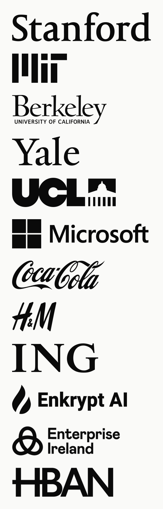

# Affiliation logos

The band under the home hero, "Expertise from": one slow, endless row of grey logos for where our team and advisors studied and worked, and the firms that invested in us. Hovering pauses it. With reduced motion turned on, it is one still, centred row that wraps. Added in November 2026.

Nine are shown: Stanford, Microsoft, MIT, ING, XRC Ventures, UC Berkeley, NextGen Venture Partners, Yale and Entrepreneurs First. Every other logo in the table below is built and ready; to swap one in, add or replace its entry in `src/content/affiliations.ts`. Coca-Cola was tried and taken out as too consumer-facing for our buyers.

The row is drawn three times side by side and slides left by one copy before starting over, so it never shows a gap. That only holds while two copies are wider than the widest screen; with nine logos one copy is already wider than the page frame. If the list ever gets much shorter, raise `COPIES` in `Affiliations.tsx`.



## Rules

These are what keep the band honest and on the right side of each owner's trademark policy. Keep to them when adding a logo.

- **Only real ties.** Each logo must match a degree, a job or an investment we can point to. No customers, partners or "as seen in" unless that is literally true, and then it belongs in a different band with a different label.
- **Wordmarks, not seals.** Universities guard their seals and crests far more tightly than their wordmarks. Use the wordmark (Stanford, Berkeley, Yale) or the everyday logo (MIT bars, UCL), never a shield or seal.
- **One colour, ours.** Every logo is redrawn in the page's ink and shown at 55% opacity, so no brand colours and no mark is made to look like it is endorsing us. Don't recolour, crop into, stretch or restyle a logo beyond that.
- **No links.** The logos don't link anywhere. A link reads as a relationship with the institution itself.
- **Site content rules still apply.** No insurer logos (ING here is ING Group, the bank).

## Files

| Logo | Basis | Source |
|---|---|---|
| Stanford University | Education | Wikimedia Commons, `Stanford wordmark (2012).svg` |
| MIT | Education | Wikimedia Commons, `MIT 2023 red logo.svg` (the current bars) |
| UC Berkeley | Education | Wikimedia Commons, `University of California, Berkeley logo.svg` |
| Yale University | Education | Wikimedia Commons, `Yale University logo.svg` |
| UCL | Education | English Wikipedia, `UCL Logo, plain background.svg` |
| Microsoft | Experience | Wikimedia Commons, `Microsoft logo (2012).svg` |
| The Coca-Cola Company | Experience | Wikimedia Commons, `Coca-Cola logo.svg` |
| H&M | Experience | Wikimedia Commons, `H&M-Logo.svg` |
| ING | Experience | Wikimedia Commons, `ING Group (wordmark).svg` |
| Enterprise Ireland | Experience | enterprise-ireland.com, site header logo |
| HBAN | Experience | hban.org, site header logo |
| Enkrypt AI | Experience | enkryptai.com, site header logo |
| Entrepreneurs First, NextGen Venture Partners, XRC Ventures, Transpose Platform | Investor | Already in `public/investors/` (also used by the "Backed by" band) |

- `design/affiliations/source/`: the files as downloaded. Keep these; everything in `public/affiliations/` is built from them.
- `design/affiliations/build-logos.mjs`: the build script.
- `public/affiliations/`: what the site serves.
- `src/content/affiliations.ts`: the list, its order and each logo's height.
- `src/components/home/Affiliations.tsx`: the band.

## Rebuild

```bash
node design/affiliations/build-logos.mjs
```

It uses `sharp`, which ships with Next.js. For each source it:

1. **Sets every colour to ink** (`#0a0a0a`), so all the logos match and the band can grey them with one opacity.
2. **Cuts the canvas to the artwork.** It renders the logo large, measures the drawn pixels and sets the SVG `viewBox` to them. Padding in a file would make that logo look smaller than the rest, since the band sizes logos by height.
3. **Strips** comments, metadata and editor markup (Inkscape, Illustrator), and fixes Yale's `viewbox`, which browsers ignore because SVG is case-sensitive.
4. For the two raster logos (Enterprise Ireland, HBAN), keeps the shape from the alpha channel, fills it with ink and trims it.

## Adding a logo

1. Find the official logo, as an SVG if you can: the organisation's brand or press page first, then Wikimedia Commons. Save it in `design/affiliations/source/`.
2. Add its name to `VECTORS` (or `RASTERS`) in the build script and run it.
3. Add an entry to `AFFILIATIONS` with the file's width and height (the script prints them) and its `basis`. Keep the order: schools, then companies, then investors.
4. Tune `h` by eye at 1280px wide. Aim for every logo to carry the same weight: wide wordmarks around `1.5`, compact or stacked ones up to `2.5`.
5. Add a row to the table above.
