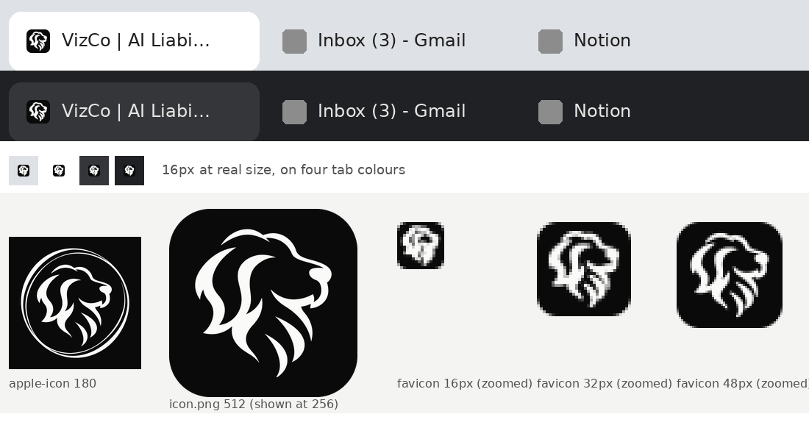

# Favicon and app icons

The browser tab icon is the hound mark: a paper-coloured head, facing right, on an ink tile. It replaced the white "Co" tile in November 2026.



## Files

| File | Size | Used for |
|---|---|---|
| `design/favicon/source.webp` | 1254 x 1254 | The mark as drawn: black on white, facing left, inside a hand-drawn double ring. Keep this; everything else is generated from it. |
| `design/favicon/build_icons.py` | | Builds the four files below. |
| `src/app/favicon.ico` | 16, 32, 48 | Browser tabs, bookmarks, Google results. Each size is drawn separately, see below. |
| `src/app/icon.png` | 512 | Modern browsers and search engines. Also the `logo` in the Organization structured data (`src/lib/seo.ts`), so keep the name. |
| `src/app/icon1.png` | 32 | The tuned 32px frame again, as a PNG. Next.js labels the `.ico` `sizes="16x16"`, so without this a high-resolution screen would shrink the 512px file instead. |
| `src/app/apple-icon.png` | 180 | iPhone and iPad home screen. |

Next.js picks up all four from `src/app/` and writes the `<link rel="icon">` and `<link rel="apple-touch-icon">` tags, with a hash in the URL so browsers drop stale copies. Don't also put a `favicon.ico` in `public/`: both would claim the same URL. The old "Co" icon lived there and was removed.

## Rebuild

```bash
python3 design/favicon/build_icons.py
```

It needs Python 3 with Pillow and numpy, and writes straight into `src/app/`.

## What the script does to the source, and why

1. **Flips it horizontally**, so the head faces right, into the page.
2. **Turns the black on white drawing into an ink mask.** Anything at 85% brightness or above is paper and anything at 25% or below is solid ink. The values in between are the drawing's own anti-aliasing and are kept.
3. **Drops the double ring for the tab sizes and the 512 icon.** At 16 and 32px each ring line is well under a pixel wide, so it turns into a grey haze around the head. The head is cropped square with 6% padding so it fills the tile.
4. **Reverses the mark out of an ink tile** (`#0a0a0a`) in page paper (`#fafaf8`). A black mark with a see-through background disappears on dark-mode tab bars; a solid tile works on light and dark. It also matches the site's "reversed out of a black block" look and the old "Co" tile. The tile has 22% rounded corners.
5. **Thickens the strokes at 16, 32 and 48px** by 0.9, 0.7 and 0.5px. The face is drawn as an outline, not a filled shape, and without this the outline of the brow and muzzle drops out and only the mane shapes remain. Each size is rendered at 16x, thickened there, then box-filtered down, and saved as its own frame in the `.ico`, rather than shrinking the 48px frame.
6. **Keeps the double ring on the 180px Apple icon,** where it is about 1.5px wide and reads well. That file is a full opaque square because iOS rounds the corners itself and fills transparency with black.
7. **Quantizes the PNGs to 64 colours.** The art is two colours plus anti-aliasing, so nothing visible is lost, and `icon.png` drops from 55KB to under 9KB.

## Checking a change

Look at the real thing, not the 512px file. A tab shows 16px on a normal screen and 32px on a high-resolution one.

- Light and dark tab bars, normal and high-resolution screens, and a pinned tab.
- Next to Gmail, Slack and Notion tabs: you should find ours at a glance.
- On an iPhone home screen (Share, Add to Home Screen).
- Browsers cache favicons hard. Use a private window, or open `/favicon.ico` directly and reload.
- Google can take weeks to pick up a new favicon in search results.

## Not done yet

- No `icon.svg`, so the icon is not vector-sharp at odd sizes. The 512px PNG covers most uses.
- No web app manifest, so no 192px Android icon.
- No orange eye. An earlier design note suggested one orange eye as the only colour, carried over from the portrait, but this mark has no eye to colour.
