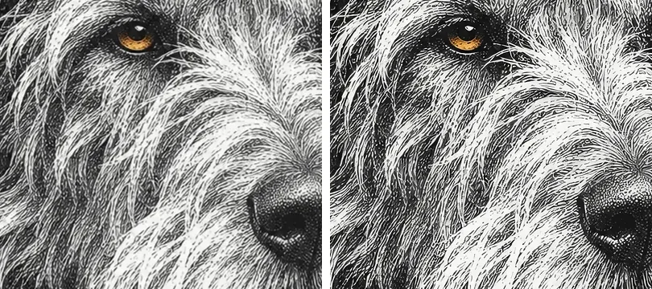

# The hero portrait: how the wolfhound was made

The home page hero is an engraved wolfhound in a suit, set like the vignette on a banknote: paper and ink, with orange only in the eyes. This doc covers where the image came from, every processing step with its exact settings, and how the page uses it. Everything here was rebuilt from the working session that made it (17 November 2026), and step 1 has been re-run and checked byte for byte.



*Left: first release (`81c7b9a`). Right: after the 4x upscale and regrade (`b37d8ac`), which is what ships now.*

## Files

| Path | What it is |
|---|---|
| `design/hero/wolfhound-source.webp` | The original artwork as uploaded. 1199 x 1312 WebP, RGB, 436,652 bytes, sha256 `078f0b2e502e83f0962493d82f8d1c3948e665b794b02e987a7d8fe184892dfd`. Keep this: it is the only input. |
| `design/hero/scripts/matte.py` | Step 1: removes the background and cleans the colour. |
| `design/hero/scripts/flatten.py` | Step 2a: puts the cut-out on paper for the upscaler. |
| `design/hero/scripts/sr.py` | Step 2b: the 4x upscale. |
| `design/hero/scripts/master.py` | Steps 3 and 4: regrade to the page paper, then export the web sizes. |
| `public/hero/wolfhound-{800,1200,1600}.webp` | What the site serves. |
| `src/components/home/portrait/` | `HeroPortrait.tsx` (the plate), `engraving.ts` (WebGL intro), `guilloche.ts` (medallion), `PlateNote.tsx` (caption). |

The scripts are kept exactly as they ran. The large intermediate files (the 1x cut-out, the 35MB upscale and the 31MB 4x master) were not saved. Re-run the steps below to get them back.

## Where the image came from

The artwork was pasted into the session as a WebP. Nothing records which tool or model made it. It had a fake transparency checkerboard baked into the pixels (grey 222 and white 254 squares of about 27.5px, with no real alpha), which is why step 1 exists.

## Step 1: cut it out (`matte.py`)

This step is pure image processing, with no AI model:

1. **Models the checkerboard.** The square size and offset were measured from the image: 27.535px wide with phase 1.60, and 27.34px tall with phase 1.40. A pixel counts as background when it is within 11 levels of the checker model and nearly colourless (saturation under 14).
2. **Flood-fills from the image border** through background pixels, so only checkerboard connected to the outside is removed.
3. **Removes enclosed pockets of checkerboard** between hair wisps. A pocket counts as background if it contains at least 30 grey and 30 white checker pixels and lies within 28px of the outline. The 28px limit stops it from eating the shirt and collar; 11 pockets are removed.
4. **Tidies the mask.** It closes one-pixel holes and drops figure specks under 40px.
5. **Un-blends the edge.** In a 4px band inside the outline, the checker that was mixed into the anti-aliased edge is divided back out, assuming ink at level 40.
6. **Makes everything neutral grey except the eyes,** which keep their amber. The eyes are two 26px circles at (548, 254) and (806, 257).
7. **Maps white to the page paper,** `#fafaf8`.
8. **Softens the alpha edge** with a 0.6px Gaussian blur, then applies levels.
9. **Exports** with Pillow as lossy WebP at quality 80, alpha quality 90, method 6.

The first release (`81c7b9a`) shipped this as `wolfhound-1200.webp` and `wolfhound-760.webp`. The "1200" file is actually 1199px wide, because the source is.

## Step 2: upscale 4x (`flatten.py`, `sr.py`)

The brief for the second pass was to make the illustration "sharper", as if it was "made in 4k".

- **Input:** the 1x cut-out flattened onto `#fafaf8`, so the upscaler sees RGB with no alpha.
- **Model:** [4x-UltraSharp](https://huggingface.co/Kim2091/UltraSharp), an ESRGAN model, run on CPU in PyTorch through the `spandrel` loader. The image is processed in 192px tiles with 16px of overlap, on 4 threads.
- **Why this model:** a face crop was run through three models. 4x-UltraSharp kept the engraving lines and stipple dots crisp. RealESRGAN_x4plus and RealESRGAN_x4plus_anime_6B smeared or flattened them.
- **Result:** 1199 x 1312 became 4796 x 5248, in about 4 minutes.

> **Licence:** 4x-UltraSharp is licensed CC BY-NC-SA 4.0, which is non-commercial. Whether a model's licence reaches the images it produces is unsettled, but this is a commercial site, so it's worth a decision. RealESRGAN_x4plus is BSD-3-Clause and was the runner-up.

## Step 3: regrade the 4x master (`master.py`)

The commit called this "regraded to the page paper with richer ink". It does four things:

1. **Alpha:** the 1x matte is scaled up 4x with Lanczos, then tightened back to about a 1px edge at 1x scale: levels from 0.3 to 0.7, then a smoothstep.
2. **Paper:** the upscale's paper tone is measured where alpha is 0 and scaled back to exactly `#fafaf8`. In practice it already measured (250, 250, 248), so this changed nothing.
3. **Neutral ink:** everything except the eyes is made grey again, because the upscaler can leave faint colour fringes in the hatching.
4. **Richer ink:** tones below half brightness get a power curve of 1.12, so the darks print deeper. Paper and light tones are untouched.

## Step 4: web sizes (`master.py`)

- **Sizes:** 1600, 1200 and 800px wide (1751, 1313 and 875 tall), resized with Lanczos.
- **Sharpening:** a light unsharp mask on the colour channels only, at radius 0.7, 45% and threshold 1.
- **Export:** lossy WebP at alpha quality 90, method 6. Quality is 82 for 1600 and 1200, and 84 for 800.
- **Results:** 840KB, 522KB and 258KB. The 760px file was retired.

## Rebuild it

You need Python 3, Pillow, numpy and scipy, plus PyTorch and spandrel for step 2. Use a scratch folder outside the repo, because the intermediate files are large.

```bash
W=/tmp/hound && mkdir -p $W/proc $W/sr $W/models
pip install pillow numpy scipy

# 1. Cut-out. Also writes the first release's 760 and 1200 WebPs.
python3 -I design/hero/scripts/matte.py design/hero/wolfhound-source.webp $W/proc 80

# 2. Upscale
python3 design/hero/scripts/flatten.py $W/proc/portrait-full.png $W/sr/input.png
pip install torch --index-url https://download.pytorch.org/whl/cpu
pip install spandrel
curl -L -o $W/models/4x-UltraSharp.safetensors \
  https://huggingface.co/Kim2091/UltraSharp/resolve/main/4x-UltraSharp.safetensors
python3 design/hero/scripts/sr.py $W/models/4x-UltraSharp.safetensors $W/sr/input.png $W/sr/full-ultrasharp.png -

# 3 and 4. Master and web sizes. The trailing slash matters.
python3 design/hero/scripts/master.py $W/
cp $W/sr/wolfhound-{800,1200,1600}.webp public/hero/
```

- **Checked:** step 1 was re-run from the committed source and gives WebPs that are byte-identical to the ones in `81c7b9a`.
- **Not re-run:** steps 2 to 4. A different PyTorch or spandrel version may give slightly different pixels.
- **Known issue:** if spandrel fails with `operator torchvision::nms does not exist`, reinstall a matching CPU torchvision:
  ```bash
  pip install --force-reinstall --no-deps torchvision --index-url https://download.pytorch.org/whl/cpu
  ```

## How the page uses it

- **A plain ``, not `next/image`.** The WebGL intro reads the same file as its texture. It uses `srcSet` for the 800, 1200 and 1600 sizes, `fetchPriority="high"`, and `width={1200} height={1313}`.
- **The intro** (`engraving.ts`) develops the engraving outward from the eyes over 2.6s. The darkest strokes print first; each stroke lands in the signal orange and cools to ink. The layer then fades into the `` and releases its WebGL context. Without WebGL there is a CSS reveal instead. Under reduced motion the plate is shown finished and still.
- **The medallion** (`guilloche.ts`) is drawn once per size on a 2D canvas, and CSS turns its two rings slowly. Its line strength is `TONE = 1.12`.
- **Values tied to this exact image.** If the image is ever recropped or regraded, change these too:
  - `EYES = [0.5646, 0.1947]` in `HeroPortrait.tsx`, the midpoint between the eyes as a fraction of the image.
  - `radial-gradient(circle at 56.5% 19.5% …)` in `globals.css`, the same point for the CSS fallback.
  - `.plate-stage { aspect-ratio: 1199 / 1312 }` in `globals.css`.
  - `PAPER = "#fafaf8"` in `HeroPortrait.tsx`. The shader treats anything darker than this as ink, so the image's paper must be exactly this colour.
